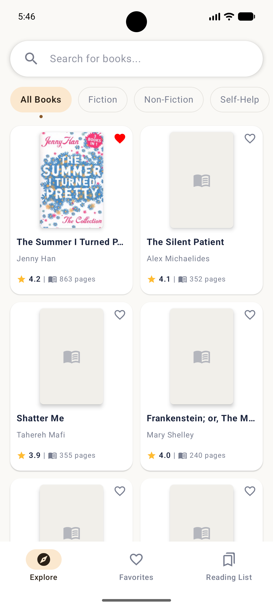
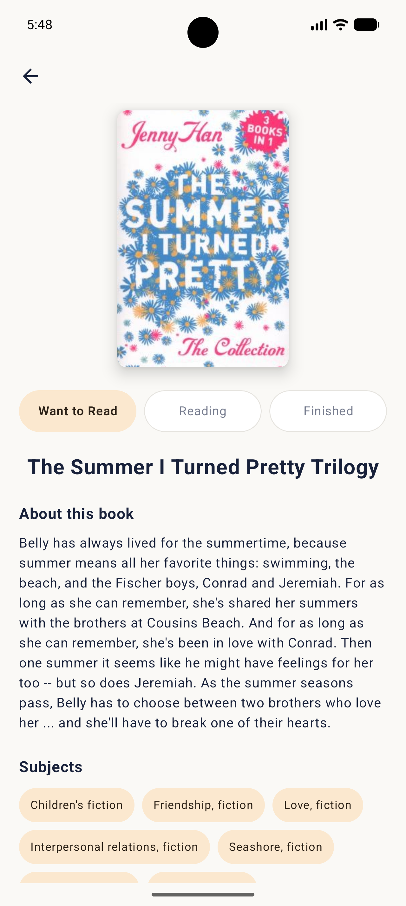
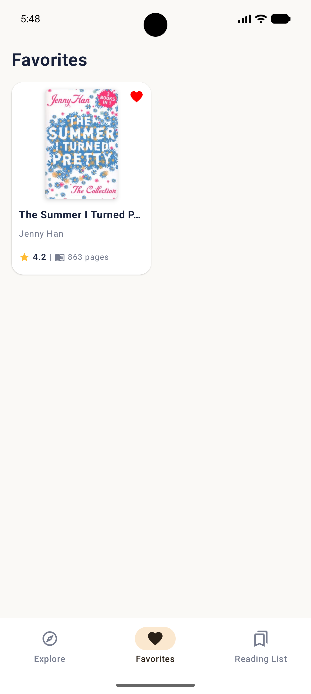
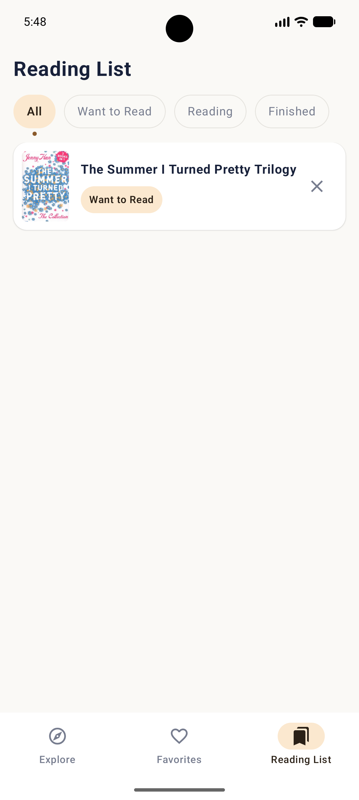
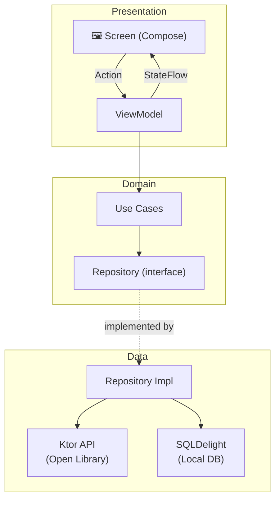
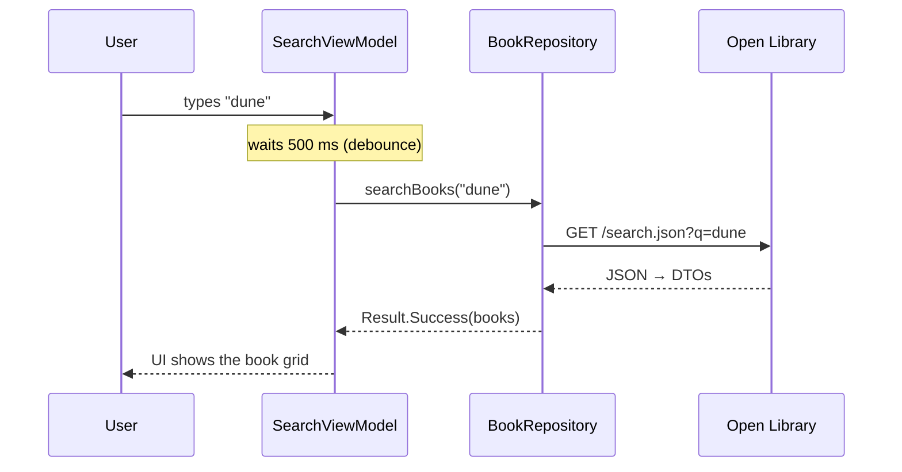
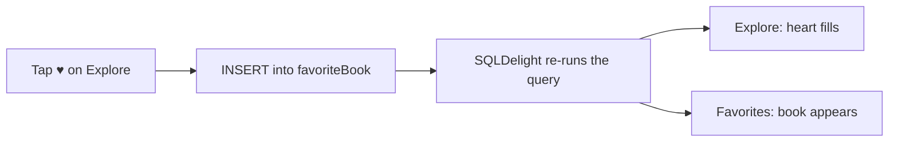

# 📚 Litera — Book App (Kotlin Multiplatform)

> **A learning project.** I built Litera to practice **Kotlin Multiplatform** and **Compose Multiplatform** with a clean, real-world architecture. It is not a production app.

Litera lets you search books from the [Open Library API](https://openlibrary.org/developers/api), browse them by category, save favorites, and track what you're reading. Saved books are stored on the device, so they work offline. **One shared codebase runs on Android, iOS and Desktop.**

## Screenshots

| Explore | Book Details | Favorites | Reading List |
|:---:|:---:|:---:|:---:|
|  |  |  |  |

## Concepts Practiced

| Concept | Used for |
|---|---|
| **Kotlin Multiplatform** | One shared codebase for Android, iOS and Desktop |
| **Compose Multiplatform** | Shared UI (cards, chips, grid, bottom bar) |
| **Clean Architecture** | Separate `presentation`, `domain` and `data` layers per feature |
| **MVI-style state** | `State` + `Action` + `ViewModel` with `StateFlow` |
| **Ktor Client** | Networking with the Open Library REST API |
| **kotlinx.serialization** | Parsing JSON into DTOs |
| **SQLDelight** | Local database for Favorites and the Reading List |
| **Koin** | Dependency injection |
| **Navigation Compose** | Type-safe routes and a bottom navigation bar |
| **Coroutines & Flow** | Debounced search and reactive database updates |
| **Coil 3** | Loading book cover images |
| **Typed error handling** | `Result<Data, DataError>` instead of exceptions |
| **expect / actual** | Platform-specific HTTP engines and database drivers |

## Architecture

Each feature (`book`, `favorites`, `readinglist`) follows **Clean Architecture**. Arrows show who calls whom. The `domain` layer has no dependency on the network, the database or the UI.



### How a search works



### Reactive local database

Favorites and the Reading List are exposed as a `Flow`. When a row changes, **every screen watching that table updates automatically**:



## Project Structure

```
shared/src/
├── commonMain/          # Shared code for all platforms
│   ├── app/             # App entry, Scaffold, routes
│   ├── core/            # Network, database, DI, shared UI components
│   ├── book/            # Search + details   (domain / data / presentation)
│   ├── favorites/       # Favorites           (domain / data / presentation)
│   ├── readinglist/     # Reading list        (domain / data / presentation)
│   ├── navigation/      # NavHost + bottom bar
│   └── sqldelight/      # .sq files (database tables & queries)
├── androidMain/         # OkHttp engine + Android SQLite driver
├── iosMain/             # Darwin engine + Native SQLite driver
└── jvmMain/             # OkHttp engine + JDBC SQLite driver (desktop)
```

## Run It

| Platform | Command |
|---|---|
| Android | Run `androidApp` from Android Studio, or `./gradlew :androidApp:assembleDebug` |
| Desktop | `./gradlew :desktopApp:run` |
| iOS | Open `/iosApp` in Xcode and run |
| Tests | `./gradlew :shared:jvmTest` |

---

Built for learning 🚀 · Data from [Open Library](https://openlibrary.org)
